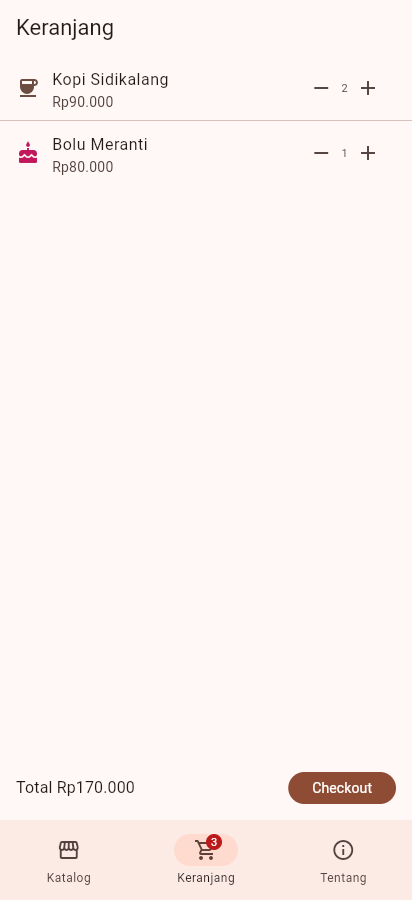

# Praktikum Pertemuan 7 — Keranjang Belanja

Pemrograman Mobile (3KOM40215) · Pertemuan 7 · Ilmu Komputer UNIMED

Fitur keranjang pada aplikasi katalog Pertemuan 6: tombol di halaman detail, badge di navigasi, dan tab Keranjang dengan pengubah jumlah, total, dan checkout. Fitur yang sama dibuat dengan dua pendekatan pada dua branch.

| | |
|---|---|
| Nama  | Muhammad Tsabat Muhyiyuddin |
| NIM   | 4243250002 |
| Kelas | PSIK24D |
| GitHub | [tsabat15](https://github.com/tsabat15) |

## Branch

| Branch | Isi |
|---|---|
| `main` | Katalog Pertemuan 6, sebelum ada keranjang |
| `keranjang-provider` | Keranjang dengan `ChangeNotifier` dan `provider` |
| `keranjang-cubit` | Keranjang dengan `Cubit` dan `flutter_bloc` |

## Cara menjalankan

```
git switch keranjang-provider     # atau keranjang-cubit
flutter pub get
flutter run -d chrome
flutter test
```

## Tangkapan layar

Diambil dari versi web di Chrome dengan lebar 412 px. Agar tidak kosong, keranjang diisi lewat kode sementara yang hanya dipakai saat mengambil gambar. Gambar tersimpan di folder `screenshots/` pada masing-masing branch.

| Provider | Cubit |
|---|---|
|  |  |

## Perbandingan (B.3)

Jumlah baris diukur dengan `git diff --stat main <branch> -- lib test`.

| Pertanyaan | Provider | Cubit |
|---|---|---|
| Berapa berkas/baris yang berubah? | 6 berkas, +237/−12 baris | 7 berkas, +276/−12 baris, termasuk 28 baris contoh Bloc sebagai pembanding |
| Di mana logika bisnis berada? | `KeranjangModel` di `lib/keranjang_model.dart` | `KeranjangCubit` di `lib/keranjang_cubit.dart`, dengan `KeranjangState` terpisah |
| Bagaimana UI mengetahui perubahan? | Model memanggil `notifyListeners()`; UI mendengarkan dengan `watch` dan `select` | Cubit memanggil `emit(stateBaru)`; UI mendengarkan dengan `BlocBuilder` dan `select` |
| Mana yang lebih mudah diuji? Mengapa? | Mudah: model diuji tanpa UI, dan notifikasi dihitung dengan `addListener` | Sedikit lebih mudah: setiap perubahan menghasilkan state baru, sehingga state lama dan baru dapat dibandingkan langsung |
| Mana yang dipilih untuk proyek akhir? Mengapa? | Cocok untuk aplikasi kecil karena kodenya lebih ringkas | **Dipilih.** Alur state lebih mudah ditelusuri dan efek samping seperti SnackBar punya tempat jelas di `BlocListener` |

## Dokumen

Lembar Kerja Praktikum (C) dan Latihan Mandiri (E) ada di `dokumen/`.

## Pernyataan penggunaan AI

Saya menggunakan asisten AI untuk membantu menyalin dan menguji kode, melengkapi versi Cubit, dan menyusun README ini. Saya bertanggung jawab memahami seluruh isinya.
